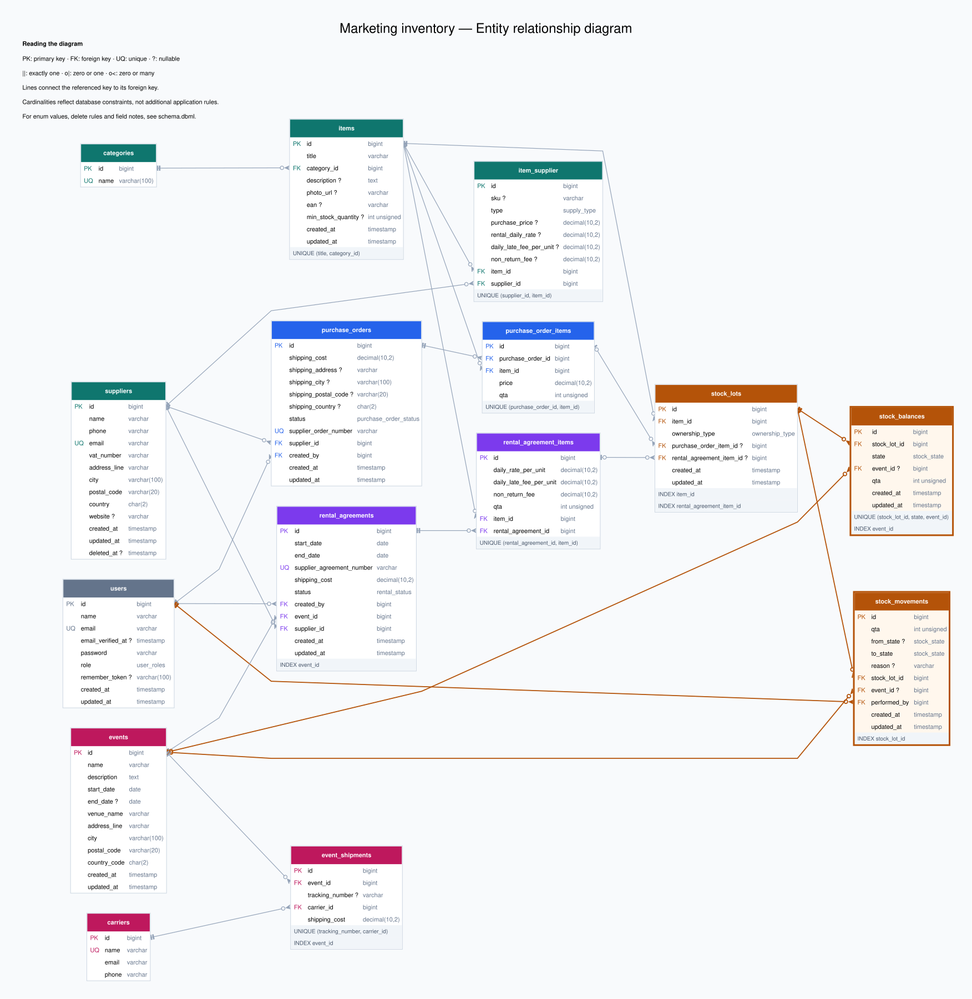

# Exercise 1: Marketing Logistics & Warehouse Schema

## ER diagram

- [Open the full diagram](https://raw.githubusercontent.com/gtoto007/marketing-inventory-exercises/refs/heads/main/es1/er-diagram.svg) to see tables, keys and relationships.
- You can find the database schema in [schema.dbml](./schema.dbml).

---

## Overview

The inventory is based on three main concepts: lots, their movements and their current quantities in each state.

- [Stock lots](#stock_lots)
  - A stock lot is a quantity of one specific [item](#items) received from a specific [purchase order](#purchase_orders) or [rental agreement](#rental_agreements).
  - A lot is created when a [purchase order item](#purchase_order_items) or [rental agreement item](#rental_agreement_items) arrives in the warehouse: each item becomes one lot, received in full.
  - The same [event](#events) can receive quantities of the same item from different stock lots, keeping track of the quantity from each lot to calculate the event cost more accurately.
- [Stock movements](#stock_movements)
  - Each stock movement records how many units of a lot change state (e.g. received at the warehouse, in transit to a specific event, lost, consumed, etc.), who performed the movement and when.
  - Rows are never updated or deleted, so each lot keeps its full history.
- [Stock balances](#stock_balances)
  - Stock balances store the real-time quantity of each stock lot in each possible state: `in_warehouse`, `in_transit_to_event` / `in_transit_from_event`, `at_event`, `consumed`, `lost` and `returned_to_supplier`. Quantities are also linked to a specific event where relevant.
  - They are updated automatically whenever a related movement is recorded in [stock_movements](#stock_movements), in the same transaction.

---

## Assumptions

- Items and suppliers
  - An [item](#items) can be offered for sale, for rent, or both by one or more [suppliers](#suppliers).
  - Supplier catalogs are imported into our database from external sources (e.g. APIs).
- Rental agreements
  - A [rental agreement](#rental_agreements) always belongs to one specific [event](#events): an item cannot be rented without linking it to an event.
  - Rented items must go back to the supplier. If they are lost or consumed (e.g. given away by mistake at the event), the non_return_fee of the rental agreement item is charged for each unit.
- Stock lots
  - A [stock lot](#stock_lots) is a quantity of one specific [item](#items) received from a specific [purchase order](#purchase_orders) or [rental agreement](#rental_agreements).
  - A lot is created when a [purchase order item](#purchase_order_items) or [rental agreement item](#rental_agreement_items) arrives in the warehouse: each item becomes one lot, received in full.
  - The same [event](#events) can receive quantities of the same [item](#items) from different [stock lots](#stock_lots), keeping track of the quantity from each lot to calculate the event cost more accurately.
- Stock movements
  - An item can be given away or lost even outside an event (e.g. a gift to a client visiting the office, or an item lost during transport), so event_id in [stock_movements](#stock_movements) is optional for consumed and lost movements.
- General
  - There is a single warehouse.
  - All prices are in the same currency.

---

## Questions

- **Q1** If a Supplier is deleted from the system, what happens to the historical "Purchase Order" associated with them? Explain your choice of onDelete behavior.

  - I added a soft delete (`deleted_at` field) and `ON DELETE RESTRICT` on the foreign key. This is a good compromise: a supplier can still be removed, it is hidden from the catalog and no new items can be bought from it, but its previous orders keep their full history. A hard delete is allowed only if the supplier is unused.

- **Q2** How do you distinguish between stock that is "owned" vs "rented" when calculating the warehouse capacity?

  - To distinguish owned from rented stock in the warehouse, I use ownership_type (OWNED or RENTED) in [stock_lots](#stock_lots). When counting the warehouse quantity of a specific item, I select records from [stock_balances](#stock_balances) that are in the in_warehouse state and linked to lots of that item. I then use each lot's ownership_type to sum owned and rented quantities separately.

  - For that item's availability at a specific [event](#events), I count all owned units in_warehouse plus only the rented units in_warehouse whose [rental agreement](#rental_agreements) belongs to that event. Without an event, I count only owned units in_warehouse.

- **Q3** If a warehouse manager accidentally marks 500 items as "Lost", how does your schema allow us to trace who did it and when?

  - Every stock change is a record in `stock_movements`, which is never updated or deleted. When the manager marks 500 items as lost, a record is created in `stock_movements` (`from_state` → `lost`, qta 500). The system stores who did it in `performed_by` and when in `created_at`.

- **Q4** How would you prevent the Marketing team from running out of an item type?

  - Each item has a `min_stock_quantity` field. After every movement, the system sums the item's `in_warehouse` quantity from `stock_balances`. If it drops below `min_stock_quantity`, the manager could be notified, or a new purchase order could be created automatically.

---

## Time spent and use of AI

**Time spent:** two days to analyze the domain, design the database and prepare the documentation.

**Use of AI:** I used AI as a sparring partner, not to produce the solution:

- **Domain clarifications**: questions about how marketing logistics and rentals usually work (e.g. late fees, non-return fees, shipments to and from events).
- **Comparing approaches**: I used it to evaluate different solutions, but I always made the final decisions and corrected it when its proposals did not fit. For example, the AI initially proposed calculating the event cost from a price stored on the item; I rejected it and designed the cost around **stock lots** instead, where each lot points to the purchase or rental item it comes from, so every unit keeps its real price and owned and rented stock are handled in the same way.
- **Formatting**: help with repetitive work such as formatting the text and the tables of this README. I reviewed everything that was written and removed the parts that were not useful.

---

## Example data flow

A manager buys 100 pens and rents 4 chairs for the event "Expo". At the end of the event, 50 pens have been given away, one chair is lost, the other 3 chairs are returned to the supplier, and 30 pens are shipped back to the warehouse, bringing the total back to 50.

1. The manager creates Expo, orders the pens from a [supplier](#suppliers) and rents the chairs from another supplier for that event.

   1.1 Expo is created in [events](#events).

   1.2 The order and its items are saved in [purchase_orders](#purchase_orders) and [purchase_order_items](#purchase_order_items), with the order in status PENDING.

   1.3 The rental and its items are saved in [rental_agreements](#rental_agreements) and [rental_agreement_items](#rental_agreement_items), with status PENDING and the agreed rates and fees; the rental agreement is linked to Expo through event_id.

2. The items arrive in the warehouse.

   2.1 The order becomes RECEIVED and the rental becomes RECEIVED; two [stock_lots](#stock_lots) are created: one OWNED for the pens and one RENTED for the chairs.

   2.2 [stock_movements](#stock_movements) records NULL → in_warehouse, attributed to the manager who ordered the items, and [stock_balances](#stock_balances) stores 100 pens and 4 chairs as in_warehouse.

3. 80 pens and all 4 chairs are shipped to [Expo](#events).

   3.1 The shared shipment is saved in [event_shipments](#event_shipments), and [stock_movements](#stock_movements) records in_warehouse → in_transit_to_event for both lots.

   3.2 [stock_balances](#stock_balances) keeps 20 pens as in_warehouse and stores 80 pens and 4 chairs as in_transit_to_event.

4. The items arrive at the event.

   4.1 [stock_movements](#stock_movements) records in_transit_to_event → at_event, and [stock_balances](#stock_balances) moves the quantities to at_event.

5. 50 pens are given away and one chair is lost.

   5.1 [stock_movements](#stock_movements) records at_event → consumed for the 50 pens and at_event → lost for the chair.

   5.2 [stock_balances](#stock_balances) stores these quantities as consumed and lost, while the remaining units stay at_event, all linked to Expo.

6. The remaining 30 pens and 3 chairs return to the warehouse.

   6.1 The shared return shipment is saved in [event_shipments](#event_shipments), and [stock_movements](#stock_movements) records both steps: at_event → in_transit_from_event → in_warehouse.

   6.2 [stock_balances](#stock_balances) first tracks the returning items as in_transit_from_event, then shows 50 pens and 3 chairs as in_warehouse, including the 20 pens that were never sent.

7. The 3 chairs are returned to the supplier on time.

   7.1 [stock_movements](#stock_movements) records in_warehouse → returned_to_supplier, and [stock_balances](#stock_balances) shows 3 chairs as returned_to_supplier and one as lost.

   7.2 The [rental_agreements](#rental_agreements) record is marked as RETURNED, with the lost chair covered by the non-return fee.

Balance records are removed when their quantity reaches zero.

### Records at the end of the flow

[stock_lots](#stock_lots), where item 1 is the pen and item 2 is the chair:

| id | item_id | ownership_type | purchase_order_item_id | rental_agreement_item_id |
|---|---|---|---|---|
| 1 | 1 | OWNED | 1 | NULL |
| 2 | 2 | RENTED | NULL | 1 |

[stock_balances](#stock_balances), where event 1 is Expo:

| stock_lot_id | state | event_id | qta |
|---|---|---|---|
| 1 | in_warehouse | NULL | 50 |
| 1 | consumed | 1 | 50 |
| 2 | lost | 1 | 1 |
| 2 | returned_to_supplier | 1 | 3 |

[stock_movements](#stock_movements):

| stock_lot_id | from_state | to_state | qta | event_id |
|---|---|---|---|---|
| 1 | NULL | in_warehouse | 100 | NULL |
| 2 | NULL | in_warehouse | 4 | NULL |
| 1 | in_warehouse | in_transit_to_event | 80 | 1 |
| 2 | in_warehouse | in_transit_to_event | 4 | 1 |
| 1 | in_transit_to_event | at_event | 80 | 1 |
| 2 | in_transit_to_event | at_event | 4 | 1 |
| 1 | at_event | consumed | 50 | 1 |
| 2 | at_event | lost | 1 | 1 |
| 1 | at_event | in_transit_from_event | 30 | 1 |
| 2 | at_event | in_transit_from_event | 3 | 1 |
| 1 | in_transit_from_event | in_warehouse | 30 | 1 |
| 2 | in_transit_from_event | in_warehouse | 3 | 1 |
| 2 | in_warehouse | returned_to_supplier | 3 | 1 |

Expo cost:

| Cost | Calculation | Amount |
|---|---|---|
| Pens given away | 50 × 2.00 | 100.00 |
| Rent for 4 chairs for 3 days | 4 × 3 × 5.00 | 60.00 |
| Lost chair | 1 × 50.00 | 50.00 |
| Rental shipping between supplier and warehouse | Fixed cost | 10.00 |
| Shared shipments to and from Expo | 30.00 + 20.00 | 50.00 |
| **Total** | | **270.00** |

---

## Tables

Legend: **PK** primary key · **NN** not null · **UQ** unique · **FK** foreign key. All FKs use `ON UPDATE CASCADE`; the `ON DELETE` action is shown for each one.

### `users`

Users of the system.

| Column | Type | Values | Constraints | Notes |
|--------|------|--------|-------------|-------|
| id | bigint unsigned | | PK, auto increment | |
| name | varchar | | NN | |
| email | varchar | | NN, UQ | |
| email_verified_at | timestamp | | | |
| password | varchar | | NN | |
| role | enum `user_roles` | `admin`: full access, manages users, can see the event cost `manager`: orders and rents items, records stock movements, plans events, can see the event cost `marketing`: orders and rents items, records stock movements, plans events, cannot see the event cost `system`: automated processes and integrations | NN | Defines what the user can do |
| remember_token | varchar(100) | | | Laravel "remember me" token |
| created_at | timestamp | | NN | |
| updated_at | timestamp | | NN | |

### `items`

Products the marketing team can buy or rent and bring to events (e.g. gadgets, banners, booths).

| Column | Type | Constraints | Notes |
|--------|------|-------------|-------|
| id | bigint unsigned | PK, auto increment | |
| title | varchar | NN | |
| category_id | bigint | NN, FK → `categories.id` | **ON DELETE RESTRICT**: a category cannot be deleted while items still belong to it |
| description | text | nullable | Content of the item |
| photo_url | varchar | nullable | |
| ean | varchar | nullable | |
| min_stock_quantity | int unsigned | nullable | When the quantity in the warehouse drops below this value, the item can be reordered automatically or the manager is notified |
| created_at | timestamp | NN | |
| updated_at | timestamp | NN | |

Indexes: `(title, category_id)` UQ: two items cannot have the same title in the same category.

### `categories`

Item categories, used to group items and for analytics (e.g. return rate per category).

| Column | Type | Constraints | Notes |
|--------|------|-------------|-------|
| id | bigint unsigned | PK, auto increment | |
| name | varchar(100) | NN, UQ | |

### `suppliers`

Companies that sell or rent items (providers and suppliers are merged into this single table).

| Column | Type | Constraints | Notes |
|--------|------|-------------|-------|
| id | bigint unsigned | PK, auto increment | |
| name | varchar | NN | |
| phone | varchar | NN | |
| email | varchar | NN, UQ | |
| vat_number | varchar | NN | |
| address_line | varchar | NN | |
| city | varchar(100) | NN | |
| postal_code | varchar(20) | NN | |
| country | char(2) | NN | |
| website | varchar | nullable | |
| created_at | timestamp | NN | |
| updated_at | timestamp | NN | |
| deleted_at | timestamp | nullable | Soft delete: a supplier linked to orders or rentals is never hard-deleted. Hard delete allowed only if the supplier is unused (ON DELETE RESTRICT) |

### `item_supplier`

Items each supplier offers (catalog), filled manually or imported from an external source. Prices and fees here are the current offer: they are copied into the order or rental items when signed.

| Column | Type | Values | Constraints | Notes |
|--------|------|--------|-------------|-------|
| id | bigint | | PK, auto increment | |
| sku | varchar | | nullable | |
| type | enum `supply_type` | `PURCHASABLE`: the supplier sells the item `RENTABLE`: the supplier rents the item `BOTH`: the supplier both sells and rents the item | NN | Says which prices below are set |
| purchase_price | decimal(10,2) | | nullable | Set if type is `PURCHASABLE` or `BOTH` |
| rental_daily_rate | decimal(10,2) | | nullable | Set if type is `RENTABLE` or `BOTH` |
| daily_late_fee_per_unit | decimal(10,2) | | default 0 | For rented items: fee charged for each unit and each day after the rental end date |
| non_return_fee | decimal(10,2) | | default 0 | For rented items: fee charged for each unit not returned |
| item_id | bigint | | NN, FK → `items.id` | **ON DELETE CASCADE**: catalog data, not history. If the item is deleted, its supplier offers are deleted too |
| supplier_id | bigint | | NN, FK → `suppliers.id` | **ON DELETE CASCADE**: catalog data, not history. Offers are deleted with the supplier (possible only if the supplier is unused) |

Indexes: `(supplier_id, item_id)` UQ

### `purchase_orders`

An order a user places with a supplier. It contains one or more items (`purchase_order_items`).

| Column | Type | Values | Constraints | Notes |
|--------|------|--------|-------------|-------|
| id | bigint unsigned | | PK, auto increment | |
| shipping_cost | decimal(10,2) | | NN | |
| shipping_address | varchar | | nullable | |
| shipping_city | varchar(100) | | nullable | |
| shipping_postal_code | varchar(20) | | nullable | |
| shipping_country | char(2) | | nullable | |
| status | enum `purchase_order_status` | `PENDING` `IN_TRANSIT` `RECEIVED` `CANCELLED` | NN, default PENDING | |
| supplier_order_number | varchar | | NN, UQ | |
| supplier_id | bigint | | NN, FK → `suppliers.id` | **ON DELETE RESTRICT**: suppliers are soft-deleted. A hard delete is allowed only if the supplier is unused |
| created_by | bigint | | NN, FK → `users.id` | **ON DELETE RESTRICT**: a user who created orders cannot be deleted, so we always know who created them |
| created_at | timestamp | | NN | |
| updated_at | timestamp | | NN | |

### `purchase_order_items`

Items of a purchase order. When received, each item becomes a stock lot.

| Column | Type | Constraints | Notes |
|--------|------|-------------|-------|
| id | bigint unsigned | PK, auto increment | |
| purchase_order_id | bigint | NN, FK → `purchase_orders.id` | **ON DELETE CASCADE**: items are part of the order and are deleted with it. If a item has already generated a stock lot, the restrict on `stock_lots` blocks the delete |
| item_id | bigint | NN, FK → `items.id` | **ON DELETE RESTRICT**: an item used in a purchase order cannot be deleted |
| price | decimal(10,2) | NN | Unit price paid, copied from the supplier offer when the order is placed |
| qta | int unsigned | NN | Quantity ordered |

Indexes: `(purchase_order_id, item_id)` UQ

### `rental_agreements`

A rental agreement with a supplier for one or more items.

| Column | Type | Values | Constraints | Notes |
|--------|------|--------|-------------|-------|
| id | bigint | | PK, auto increment | |
| start_date | date | | NN | |
| end_date | date | | NN | CHECK `end_date >= start_date` |
| supplier_agreement_number | varchar | | NN, UQ | |
| shipping_cost | decimal(10,2) | | NN | |
| status | enum `rental_status` | `PENDING` `IN_TRANSIT` `RECEIVED`: items received from supplier `RETURNED`: items given back to supplier `CANCELLED` | NN, default PENDING | |
| created_by | bigint | | NN, FK → `users.id` | **ON DELETE RESTRICT**: a user who created rental agreements cannot be deleted, so we always know who created them |
| event_id | bigint | | NN, FK → `events.id` | Always set: an item cannot be rented without an event. **ON DELETE RESTRICT**: an event with rental agreements cannot be deleted, since rentals are part of the event cost |
| supplier_id | bigint | | NN, FK → `suppliers.id` | **ON DELETE RESTRICT**: a supplier with rental agreements cannot be hard-deleted (soft delete only) |
| created_at | timestamp | | NN | |
| updated_at | timestamp | | NN | |

Indexes: `event_id`

### `rental_agreement_items`

Rented items of an agreement, with the conditions agreed at signing. When received, each item becomes a stock lot.

| Column | Type | Constraints | Notes |
|--------|------|-------------|-------|
| id | bigint | PK, auto increment | |
| daily_rate_per_unit | decimal(10,2) | NN | Daily rate for each unit, agreed at signing |
| daily_late_fee_per_unit | decimal(10,2) | NN, default 0 | Charged for each unit and each day after the agreement `end_date` |
| non_return_fee | decimal(10,2) | NN, default 0 | Charged for each unit lost or not returned |
| qta | int unsigned | NN | Quantity rented |
| item_id | bigint | NN, FK → `items.id` | **ON DELETE RESTRICT**: an item used in a rental agreement cannot be deleted |
| rental_agreement_id | bigint | NN, FK → `rental_agreements.id` | **ON DELETE CASCADE**: items are part of the agreement and are deleted with it. If a item has already generated a stock lot, the restrict on `stock_lots` blocks the delete |

Indexes: `(rental_agreement_id, item_id)` UQ

### `stock_lots`

Every received purchase or rental item becomes a lot. The lot points to the [purchase order item](#purchase_order_items) or [rental agreement item](#rental_agreement_items) it comes from, so I can track the stock and its agreed purchase price or rental rates.

| Column | Type | Values | Constraints | Notes |
|--------|------|--------|-------------|-------|
| id | bigint | | PK, auto increment | |
| item_id | bigint | | NN, FK → `items.id` | **ON DELETE RESTRICT**: an item with stock lots cannot be deleted |
| ownership_type | enum `ownership_type` | `OWNED` `RENTED` | NN | |
| purchase_order_item_id | bigint | | nullable, FK → `purchase_order_items.id` | Set only for OWNED lots (price from `purchase_order_items`). **ON DELETE RESTRICT**: keeps the link to the purchase (origin and unit cost of the lot) |
| rental_agreement_item_id | bigint | | nullable, FK → `rental_agreement_items.id` | Set only for RENTED lots (daily rate and fees from `rental_agreement_items`). **ON DELETE RESTRICT**: keeps the link to the rental agreement (which supplier the lot must be returned to) |
| created_at | timestamp | | NN | |
| updated_at | timestamp | | NN | |

Indexes: `item_id`, `rental_agreement_item_id`

### `stock_movements`

Append-only history of every change to a lot (`from_state` → `to_state`), see [Example data flow](#example-data-flow). Rows are never updated or deleted. Every movement updates `stock_balances` in the same transaction.

| Column | Type | Values | Constraints | Notes |
|--------|------|--------|-------------|-------|
| id | bigint | | PK, auto increment | |
| qta | int unsigned | | NN | |
| from_state | enum `stock_state` | `in_warehouse` `at_event` `in_transit_to_event` `in_transit_from_event` `consumed` `lost` `returned_to_supplier` | nullable | NULL only when goods are received from a supplier |
| to_state | enum `stock_state` | `in_warehouse` `at_event` `in_transit_to_event` `in_transit_from_event` `consumed` `lost` `returned_to_supplier` | NN | |
| reason | varchar | | nullable | Optional explanation (e.g. "damaged during transport") |
| stock_lot_id | bigint | | NN, FK → `stock_lots.id` | **ON DELETE RESTRICT**: movements are the stock history, so a lot with movements cannot be deleted |
| event_id | bigint | | nullable, FK → `events.id` | Event the movement belongs to, if any. **ON DELETE RESTRICT**: an event with stock movements cannot be deleted |
| performed_by | bigint | | NN, FK → `users.id` | Who did the movement. Movements generated by the system or by external integrations (e.g. carrier webhooks) are assigned to a dedicated user with role `system`. Movements triggered indirectly by a user action are attributed to that user. **ON DELETE RESTRICT**: a user who performed movements cannot be deleted, so we always know who did what and when (Q3) |
| created_at | timestamp | | NN | When the movement was done |
| updated_at | timestamp | | NN | |

Indexes: `stock_lot_id`

### `stock_balances`

Real-time quantity of each lot per state and event (e.g. how many units are in the warehouse, in transit to an event, consumed or lost).

| Column | Type | Values | Constraints | Notes |
|--------|------|--------|-------------|-------|
| id | bigint | | PK, auto increment | |
| stock_lot_id | bigint | | NN, FK → `stock_lots.id` | **ON DELETE RESTRICT**: a lot with a stock balance cannot be deleted |
| state | enum `stock_state` | `in_warehouse` `at_event` `in_transit_to_event` `in_transit_from_event` `consumed` `lost` `returned_to_supplier` | NN | |
| event_id | bigint | | nullable, FK → `events.id` | Required when state is `in_transit_to_event`, `at_event`, `in_transit_from_event`. Optional for `lost` or `consumed` (a gadget can also be given away outside of an event). NULL otherwise. **ON DELETE RESTRICT**: an event that still has stock linked to it cannot be deleted |
| qta | int unsigned | | NN | Current quantity. For each lot, the sum over all states equals the quantity received |
| created_at | timestamp | | NN | |
| updated_at | timestamp | | NN | |

Indexes: `(stock_lot_id, state, event_id)` UQ, `event_id`

### `events`

Events where items are shipped, used, given away or lost.
Event cost = consumed/lost owned units × price + rental agreements + `event_shipments`.

| Column | Type | Constraints | Notes |
|--------|------|-------------|-------|
| id | bigint | PK, auto increment | |
| name | varchar | NN | |
| description | text | NN | |
| start_date | date | NN | |
| end_date | date | nullable | CHECK `end_date >= start_date` |
| venue_name | varchar | NN | |
| address_line | varchar | NN | |
| city | varchar(100) | NN | |
| postal_code | varchar(20) | NN | |
| country_code | char(2) | NN | |
| created_at | timestamp | NN | |
| updated_at | timestamp | NN | |

### `event_shipments`

Shipments to and from an event, with carrier, tracking number and cost.

| Column | Type | Constraints | Notes |
|--------|------|-------------|-------|
| id | bigint | PK, auto increment | |
| event_id | bigint | NN, FK → `events.id` | **ON DELETE RESTRICT**: an event with shipments cannot be deleted, since shipping costs are part of the event cost |
| tracking_number | varchar | nullable | |
| carrier_id | bigint | NN, FK → `carriers.id` | **ON DELETE RESTRICT**: a carrier used in shipments cannot be deleted |
| shipping_cost | decimal(10,2) | NN | |

Indexes: `(tracking_number, carrier_id)` UQ, `event_id`

### `carriers`

Shipping companies used for event shipments.

| Column | Type | Constraints | Notes |
|--------|------|-------------|-------|
| id | bigint | PK, auto increment | |
| name | varchar | NN, UQ | |
| email | varchar | NN | |
| phone | varchar | NN | |
